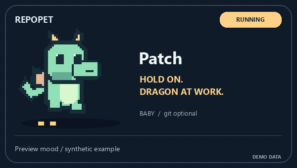

<p align="center">
  
</p>

# RepoPet · Your repo has feelings.

**Give your README a tiny dragon. Let your test results decide its mood.**

[Try the playground](https://l422145205-source.github.io/showcase-skills/) · [中文介绍](README.zh-CN.md) · [The Skill](skills/repo-pet/SKILL.md) · [Evidence & CI recipe](skills/repo-pet/references/evidence.md)

Patch celebrates green checks, throws a tiny tantrum when tests break, and takes a nap when everything is skipped. Original animated pixel art, rendered locally with Python. **No model, API key, or account required to render.**

## Adopt Patch

Install with the [Skills CLI](https://www.skills.sh/docs/cli):

```sh
npx skills add l422145205-source/showcase-skills --skill repo-pet
```

Then ask your agent:

> Use `$repo-pet` to give this repository a mint dragon named Patch. Use my existing JUnit report and add the GIF to README.md.

The agent locates this Skill's helper, checks Pillow, renders the GIF and updates only a marked README block. The renderer also works on its own:

```sh
git clone https://github.com/l422145205-source/showcase-skills.git
cd showcase-skills
python -m venv .venv
# Activate .venv with the command for your shell, then:
python -m pip install -r requirements.txt
python skills/repo-pet/scripts/repopet.py demo --out repopet-demo
```

Open `repopet-demo/passing/pet.gif`. Already have a report? Render a pet for your own project:

```sh
python skills/repo-pet/scripts/repopet.py render \
  --repo ../your-project --junit ../your-project/junit.xml \
  --out ../your-project/assets/repopet --readme ../your-project/README.md
```

The standalone commands require **Python 3.10+ and Pillow 10.1+**. `render` does not call an AI model. `npx skills add` needs Node.js; it is optional for the standalone renderer. Shell continuation syntax above is for bash; use one line in PowerShell.

## Five moods. One small dragon.

| All green. Snack time. | Build broken. Still cute. | Hold on. Dragon at work. |
| :---: | :---: | :---: |
|  |  |  |

These are **labeled synthetic previews**, not this repository's CI. [Play with all five moods →](https://l422145205-source.github.io/showcase-skills/)

| Input signal | Patch's reaction |
| --- | --- |
| JUnit records executed passes with no failures/errors | Happy dance |
| Any recorded failure/error, or failed workflow | Tiny tantrum |
| Workflow queued or in progress | Busy dragon |
| All test cases skipped, or workflow explicitly skipped | Nap time |
| Missing/invalid report, cancelled/neutral workflow, no individual cases | Just vibes; status unknown |

A successful workflow is labeled **CI evidence**, not a fabricated test count. A missing report never becomes a passing badge. Images are snapshots; rerun the command to refresh them. [Full input rules and CI integration →](skills/repo-pet/references/evidence.md)

## Grow your dragon


Reachable local commits unlock **egg (0–2) → baby (3–24) → dragon (25+)**. This is cosmetic, not a contribution score. Shallow clones count only available history; use full history if that matters. No Git repository? Patch starts as a baby.

```sh
python skills/repo-pet/scripts/repopet.py render --repo . --theme lilac --name Pixel --stage dragon
```

Choose **mint, lilac or peach**; select a stage manually when you just want the look. Demo previews use a baby. Git history and CI status are independent: an older dragon can still have a broken build.

## Small footprint, clear boundaries

- Reads a supplied JUnit XML/workflow JSON, plus a local aggregate commit count. No remote calls in the renderer.
- Exports `pet.gif`, `pet.png` and `status.json`. No author names, emails, commit messages, remote URLs or source paths enter these artifacts.
- Never runs tests, installs system packages, pushes commits or creates write-enabled workflows by itself.
- README editing is opt-in and confined to `<!-- repopet:start -->` / `<!-- repopet:end -->`.

You choose the pet name; use a public alias if you plan to publish its image. Skill installers have their own network/telemetry behavior; RepoPet does not change those settings.

## Make another little dragon

Requests for new expressions, palettes and original creature designs are welcome in [Issues](https://github.com/l422145205-source/showcase-skills/issues). If Patch makes your README more fun, a Star helps other people discover it.

Run the behavior checks with `python -m unittest discover -s tests -v`. Rebuild the gallery with `python scripts/build_showcase.py`.

MIT licensed. All dragon sprites in this repository are original code-drawn artwork.
