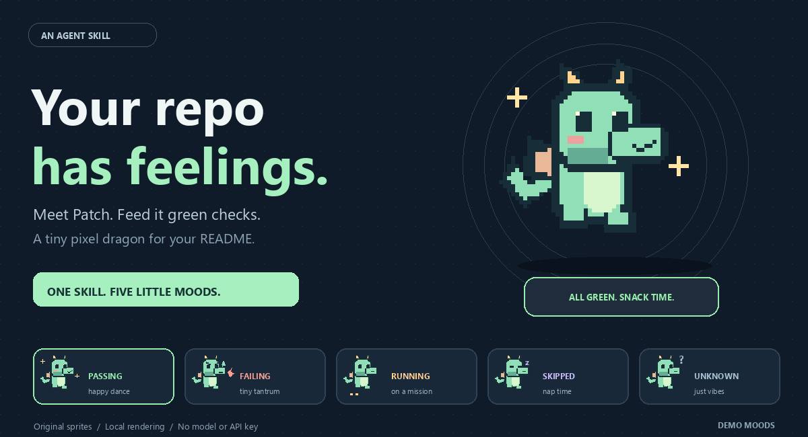

# RepoPet · 给你的仓库养一只小龙



**绿灯就撒欢，红灯就炸毛，没事就睡觉。** 把真实测试结果变成 README 里的像素宠物。

[在线试玩](https://l422145205-source.github.io/showcase-skills/) · [English](README.md) · [Skill 指令](skills/repo-pet/SKILL.md)

## 领养 Patch

```sh
npx skills add l422145205-source/showcase-skills --skill repo-pet
```

安装后对你的 Agent 说：

> 用 `$repo-pet` 给这个仓库养一只薄荷绿的小龙，名字叫 Patch。读取已有的 JUnit 测试报告，把动图放进 README。

生成图片不需要模型或 API Key。只需要 Python 3.10+ 和 Pillow 10.1+；安装 Skill 的命令另外需要 Node.js。也可以直接克隆仓库运行，不安装 Skill：

```sh
git clone https://github.com/l422145205-source/showcase-skills.git
cd showcase-skills
python -m venv .venv
# 按你的终端类型激活 .venv 后执行：
python -m pip install -r requirements.txt
python skills/repo-pet/scripts/repopet.py demo --out repopet-demo
```

打开 `repopet-demo/passing/pet.gif` 就能看到效果。下面这条命令给你的真实项目生成动图，并只替换 README 中属于 RepoPet 的标记区：

```sh
python skills/repo-pet/scripts/repopet.py render --repo ../your-project --junit ../your-project/junit.xml --out ../your-project/assets/repopet --readme ../your-project/README.md
```

## 它会怎么“闹情绪”？

| 状态 | 表现 | 数据依据 |
| --- | --- | --- |
| 通过 | 开心晃尾巴、冒星星 | 存在实际执行通过的用例，且无失败/错误；或 CI 成功 |
| 失败 | 炸毛、冒小火花 | 有失败/错误用例，或工作流失败 |
| 运行中 | 等待动画 | 工作流排队或执行中 |
| 跳过 | 闭眼打盹 | 全部用例跳过，或工作流明确跳过 |
| 未知 | 一脸问号 | 缺报告、报告损坏、无用例或 CI 取消/结果中立 |


首页与试玩页使用**明确标注的合成示例**。生成图片是某一时刻的快照，重新运行才会刷新。CI 成功不等于“测试全部通过”，因此不编造用例数量；报告缺失也不会假装通过。[详细依据与 CI 接入方法](skills/repo-pet/references/evidence.md)

## 从蛋到小龙


读取本地可达提交数：**0–2 次为蛋、3–24 次为幼龙、25 次以上为成龙**。这只是外观彩蛋，不是贡献质量评分。浅克隆只能统计已获取的历史；非 Git 目录默认幼龙。

还可以自选薄荷绿、淡紫或蜜桃色，手动指定外形：

```sh
python skills/repo-pet/scripts/repopet.py render --repo . --theme peach --name Mochi --stage dragon
```

## 公开时不用交出个人资料

渲染器仅使用测试汇总、工作流状态和提交总数，不读取作者、邮箱、提交说明、远程仓库地址，不把源文件路径写进图片/JSON。不会自动运行测试、推送代码或给工作流添加写权限。宠物名字由你指定，公开时建议使用昵称。

想要别的表情、配色或原创小生物？欢迎在 [Issues](https://github.com/l422145205-source/showcase-skills/issues) 留下想法。喜欢它的话，点个 Star 可以帮下一位养龙人找到这里。

MIT 开源；像素龙由代码原创绘制。测试：`python -m unittest discover -s tests -v`。
